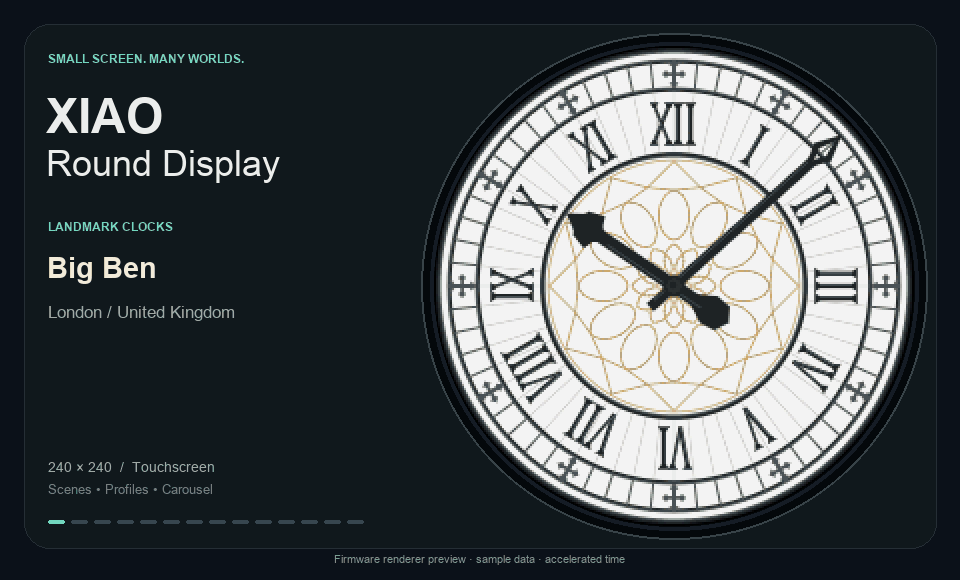

# XIAO Round Display

A customizable desk display for the **Seeed Studio XIAO nRF54LM20A Sense** and
**240 × 240 Seeed Round Display**, with a native **Swift/AppKit macOS menu bar app**.



*26-second firmware-renderer preview in a stylised bezel. Usage and printer data
are illustrative; animation time is accelerated. [How this GIF is made](docs/media/README.md).*

This is a blank, user-configurable template. It contains the working scene and
control code, with **no configured device, accounts, printer, location, saved
profiles, live readings or enabled network feeds**. Integrations are opt-in.

The helper supports USB and experimental paired Bluetooth LE for scene selection, profiles,
appearance, brightness and live data. See [Bluetooth setup](docs/BLUETOOTH.md).
New rendering code still needs a USB firmware upload. Bluetooth permissions and
reconnection on the final package, plus complete wireless Sun-image delivery,
still need physical verification; use USB as the initial/recovery path.

## Scenes

- Ten analogue clock faces, inspired by landmark clocks, with day/night palettes.
- Schematic analemma, Moon phase, current planetary positions and a Sun/NOAA card.
- Three nested star-system animations, including a clearly labelled historical
  mass-transfer illustration for HR 6819, available separately from its present view.
- Conway's Game of Life on a grid extending beyond the circular viewport.
- Empty Codex-usage and Bambu-printer scenes, ready for the new user's own feeds.

The menu bar app provides scene selection, a persistent carousel checklist with
All/None/mixed states, carousel/hold/interval controls, named Profiles, appearance,
brightness and screen-power controls. Profiles contain settings, not credentials.
All scenes remain in source when excluded from the carousel. Retired modules
are preserved separately in `optional_assets/`.

## Hardware

| Part | Quantity |
|---|---:|
| XIAO nRF54LM20A Sense, preferably with soldered headers | 1 |
| Seeed Round Display for XIAO, 240 × 240 GC9A01A | 1 |
| USB data cable to the Mac | 1 |
| Optional CR927 clock-backup cell | 1 |

The XIAO's USB socket faces outward. The display connects through its XIAO
sockets. This firmware uses the existing Seeed pinout: D1 LCD CS, D3 LCD DC,
D8 clock, D10 MOSI, D4/D5 touch/RTC I²C, D7 touch interrupt and D6 backlight.
The board is **not an ESP32 and has no Wi-Fi**. The Mac fetches live data over
its network and sends display packets over USB or paired Bluetooth LE.

## Start here

Read [SETUP.md](docs/SETUP.md) for compiling firmware and building/installing the
Mac app. Give [LLM_SETUP.md](docs/LLM_SETUP.md) to an LLM helping configure a new
user's installation. [AGENTS.md](AGENTS.md) describes the project boundaries.

```sh
python3 -m venv .venv
source .venv/bin/activate
python -m pip install -r requirements.txt
python companion/configure.py --list-devices
# Select your own device from that list; no port is preselected.
python companion/configure.py --device /dev/cu.usbmodemYOUR_DEVICE
python companion/service/manage.py install
```

Compile and flash the firmware using the separate instructions before expecting
the scene controls to work. Installing the helper does not flash a board.
The app builds locally with `swiftc`, uses one Python worker, starts at login
through a per-user LaunchAgent and has no Dock icon. There is no prebuilt app
containing someone else's Python path or system registration.

## Empty by default

The helper's own application-data directory is
`~/Library/Application Support/XIAO Display Helper/`. It is distinct from other
installations. `XIAO_DISPLAY_DATA_DIR` can override it for tests or a separate
instance. Copying the example configuration is optional; the defaults are already
empty. Select only the sources the owner actually wants:

```sh
python companion/configure.py --enable sun
python companion/configure.py --enable codex
# Pair a printer locally before enabling its feed:
python companion/pair_printer.py --host YOUR_PRINTER_IP
python companion/configure.py --enable bambu
```

Restart the helper after configuration changes. Codex uses the new user's
already-signed-in local CLI; it does not require an API key in this repository.
Printer pairing prompts for the new user's serial and hidden LAN access code,
requires an explicit certificate-trust decision and stores them locally with
restricted permissions. It never imports another application's credentials.
The printer connection subscribes to status reports and issues no print-control
commands. See [PRIVACY.md](docs/PRIVACY.md).

## Controls and scheduling

- Double-tap the glass near 12 o'clock to advance through included scenes.
- Tap the centre of a clock to change watch face; scene-specific taps reveal information.
- Right-edge swipes adjust brightness. **Turn KE switch2 ON** to connect D6 to
  the backlight; with `ON KE` above `1 2`, slide2 upward. See the illustrated
  [hardware brightness setup](docs/SETUP.md#2-enable-hardware-brightness-control-ke-switch-2).
- The carousel is configurable from the menu. Selecting no scenes pauses it on
  the current scene. Manual scene selection remains available.
- Night palette: 17:00–07:30; USB screen sleep: 01:00–07:00, in configured civil time.
  A clock advances to the next watch face at half past the hour while visible.
- Startup brightness is **60%**, after the first frame is ready.
  Old saved brightness is never replayed automatically on boot/reconnect.

UTC is the neutral time default. A single local configuration command can write
matching fixed-offset firmware settings for another location. Daylight-saving
transitions require updating the fixed offset; automatic DST is not implemented.

## Validation and dependencies

The original hardware architecture is retained. This public template's blank
configuration and build are checked separately; no new user's printer/account
connection is claimed to have been tested. Run the offline checks described in
[SETUP.md](docs/SETUP.md) before changing code.

Third-party notices remain with their code and fonts; see
[THIRD_PARTY.md](THIRD_PARTY.md). Public publication does not change those terms.
No project-wide license for the original application code has been selected yet.
